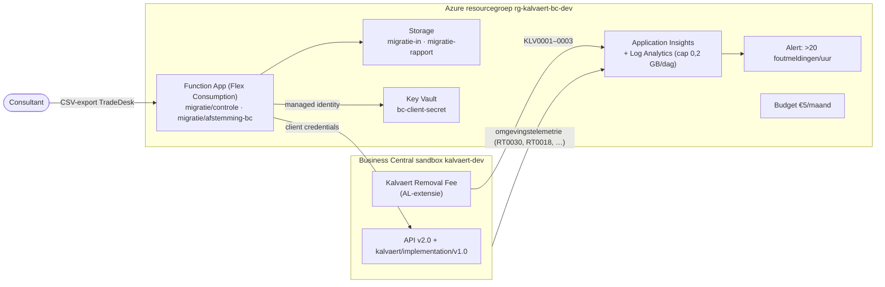

# Azure: de ontwikkelomgeving naast Business Central

> Wat: wat een Business Central-partner voor een project als Kalvaert in Azure zet, als code ([Bicep](main.bicep)), met kostenrem. Voor wie: de functional consultant (hypercare, migratiecontrole), de developer (telemetrie, integratie), de klant (wat kost het). Vorige stap: [bc/](../bc/README.md).

## Status

| | |
|---|---|
| Gebouwd | [`main.bicep`](main.bicep) (resourcegroep, ±€0–5 per maand), [twee functies](functions/src/functions/migration.mjs) met dezelfde logica als de workbench, [8 hypercare-queries](telemetry/hypercare.kql) in KQL |
| Gecontroleerd | Bicep build + lint zonder waarschuwingen (CI, job `azure`) · de functielogica met tests zonder Azure ([`tests/azure-functions.test.mjs`](../tests/azure-functions.test.mjs)): migratiecontrole stopt export v1 met €1.586,40 verschil, laat v2 door, en de afstemming tegen BC volgt de API-paginering |
| **Nog niet** | **gedeployed.** Een deployment kost (weinig) geld en gebeurt alleen na akkoord: `azure/scripts/deploy.sh` toont eerst een *what-if* en vraagt bevestiging. De KQL-queries zijn geschreven op de gedocumenteerde telemetrievelden, nog niet gedraaid op echte telemetrie. |

## Hoe het samenhangt



| Onderdeel | Waarom in dit project | Requirement / fase |
|---|---|---|
| **Application Insights** | Business Central stuurt telemetrie (foutmeldingen bij gebruikers, trage AL, mislukte jobs, API-oproepen) naar een eigen Application Insights. Zonder dat is hypercare gissen op basis van mails. De extensie logt haar eigen signalen (bijdrageregel toegevoegd, verwijderd omdat de klant niet BINNENL is). | [hypercare](../docs/07-go-live/hypercare.md) |
| **Functie `migratie/controle`** | Elke export uit het oude pakket gaat eerst door dezelfde controle als in de case: kolommen, dubbels, klantnummers, tekens, en de afstemming met het saldo op de cutoffdag. Export en rapport worden bewaard, zodat elke generale repetitie een spoor heeft. | MIG-06, [afstemming](../docs/06-migratie/afstemming.md) |
| **Functie `migratie/afstemming-bc`** | Na het laden: openstaande klantposten in BC (API) tegen dezelfde saldi. Dat is go/no-go-criterium "klantvorderingen". | [go-live](../docs/07-go-live/README.md) |
| **Key Vault** | Het secret van de Entra-app die de BC-API aanspreekt, nooit in app settings, scripts of git. | — |
| **Budget + daglimiet logs** | Een sandbox die veel logt, mag geen factuur geven. | — |

## Kosten (schatting, West-Europa, 2026)

| Onderdeel | Bij dit gebruik |
|---|---|
| Log Analytics + Application Insights | eerste 5 GB/maand inbegrepen; daglimiet 0,2 GB → hooguit ±€15 als elke dag de limiet haalt, in de praktijk €0 |
| Function App, Flex Consumption | gratis maandelijkse schijf; een paar honderd oproepen = €0 |
| Storage (LRS, enkele MB) | < €0,10 |
| Key Vault | < €0,10 (per 10.000 bewerkingen) |
| Log-alert (1 regel, elk uur) | ±€0,50 |
| **Totaal** | **±€1 per maand**, met een budgetmelding bij €4 (80% van €5) |

Alles verwijderen: `az group delete --name rg-kalvaert-bc-dev`.

## Deployen (na akkoord)

```sh
az login                                   # tenant en abonnement van de ontwikkelomgeving
KALVAERT_ALERT_EMAIL=jij@example.com azure/scripts/deploy.sh rg-kalvaert-bc-dev westeurope
```

Het script maakt de resourcegroep, toont een **what-if**, vraagt bevestiging, deployt, en publiceert de functies (`func` = [Azure Functions Core Tools](https://learn.microsoft.com/azure/azure-functions/functions-run-local)). Met `BC_CLIENT_ID` en `BC_CLIENT_SECRET` gaat ook de afstemming tegen BC aan.

Daarna, in Business Central:

1. **Omgevingstelemetrie**: beheercentrum → *Environments* → `kalvaert-dev` → *Telemetry* → de `appInsightsConnectionString` uit `azure/.deployment-outputs.json`.
2. **Extensietelemetrie**: dezelfde connection string in `bc/apps/removal-fee/app.json` als `"applicationInsightsConnectionString"`, opnieuw compileren en publiceren.
3. **Entra-app voor de API**: app-registratie met de BC-API-machtigingen `API.ReadWrite.All` en `Automation.ReadWrite.All` (toepassing), toegevoegd in BC op de pagina *Microsoft Entra-toepassingen* met de machtigingenset `D365 BUS FULL ACCESS` + `KLV DEMO SETUP`.

## Lokaal draaien zonder Azure

```sh
node --test tests/azure-functions.test.mjs       # de logica, zonder Azure
cd azure/functions && npm install && cp local.settings.example.json local.settings.json && func start
curl -X POST --data-binary @../../data/migration/klantposten-export-v1.csv "http://localhost:7071/api/migratie/controle"
# → 422 met "Niet laden: €1586.4 verschil …"; met export v2 → 200 "Klaar om te laden"
```
