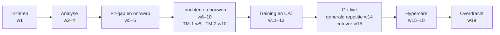

# Projectplan — 19 weken van kick-off tot overdracht

> Wat: de fasen, mijlpalen en afhankelijkheden. Voor wie: klant en projectteam. De projectmanager is eigenaar van dit plan; de functional consultant levert de inhoud per fase. Vorige stap: [context](../00-context/README.md) · volgende: [workshopplan](../01-discovery/workshopplan.md).
>
> *Illustratieve planning.*

| Fase | Weken | Wat er klaar moet zijn | Wie tekent af |
|---|---|---|---|
| Initiëren | 1 | projectorganisatie, workshopplanning, toegang sandbox | zaakvoerder |
| Analyse | 2–4 | <!--n:workshops.total-->5<!--/n--> workshopverslagen, open vragen met eigenaar | key users per domein |
| Fit-gap en ontwerp | 5–6 | [fit-gap](../03-fit-gap/fit-gap.md) met <!--n:req.total-->25<!--/n--> requirements, setup-ontwerp, spec VK-10 | zaakvoerder, boekhoudkantoor (financiën) |
| Inrichten en bouwen | 6–10 | setup in sandbox, extensie, connector, TM-1 en TM-2 | functional consultant (intern), key users (steekproeven) |
| Training en UAT | 11–13 | key users getraind, <!--n:uat.total-->17<!--/n--> scenario's afgetekend | key users |
| Go-live | 14–15 | generale repetitie, cutover, go/no-go | zaakvoerder op advies van PM en FC |
| Hypercare | 15–18 | dagelijkse opvolging, structurele fixes | PM |
| Overdracht | 19 | kennisbank, open punten, fase 2-lijst | support van de partner, zaakvoerder |

## Kritieke afhankelijkheden

1. **Rekeningschema van het boekhoudkantoor (week 5).** Zonder afgetekend schema geen boekingsgroepen, geen testmigratie.
2. **Opschoning artikelstam door aankoop (vóór TM-1, week 8).** Dubbels die niet beslist zijn, worden niet gemigreerd.
3. **Keuze Peppol-connector door financiën (week 6).** Contract en testomgeving van de aanbieder.
4. **Beschikbaarheid key users in week 12–13.** Magazijn zit dan in de piek; zie risico R6 in de [RACI en RAID](raci.md#raid).

## Change requests

Alles wat niet in de offerte staat, wordt een change request via de projectmanager. Voorbeeld: [CR-01 eindejaarsbonus](cr-01-eindejaarsbonus.md). Status van het project in week 7: [statusrapport](statusrapport-week-07.md).
