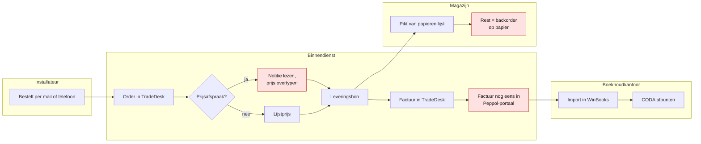
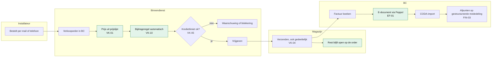

# Order-to-cash: vandaag en straks

> Wat: het verkoopproces van Kalvaert, zoals het nu loopt (uit [W-VK](../01-discovery/workshops.md#w-vk--verkoop-van-offerte-tot-betaling-week-2)) en zoals het in Business Central zal lopen. Voor wie: klant (herkennen en valideren), projectteam. Vorige stap: [workshops](../01-discovery/workshops.md) · volgende: [fit-gap](../03-fit-gap/README.md).
>
> Swimlanes als eenvoudige flowchart: voor een kmo-implementatie leest een zaakvoerder dit sneller dan volledige BPMN.

## Vandaag (as-is)

**Knelpunten (rood):** prijs overtypen (fouten, afhankelijk van één medewerker) · factuur twee keer ingeven · backorders op papier · marge per vestiging alleen via Excel.

## Straks (to-be in Business Central)

**Wat verandert en waarom**

| Was | Wordt | Requirement | Wie merkt het |
|---|---|---|---|
| Prijs overtypen uit een notitie | prijs komt uit de prijslijst; uitzonderingen per klant | VK-01 | binnendienst, installateur (juiste prijs) |
| Bijdrage soms vergeten | automatisch, alleen bij Belgische leveringen | VK-10 | boekhouding (geen verlies meer) |
| Backorders op papier | openstaand saldo op de order, dagelijkse werklijst | VK-04 | magazijn, binnendienst |
| Factuur twee keer ingeven | één keer boeken, Peppol vanuit BC | EF-01 | binnendienst |
| Marge per vestiging in Excel | dimensies op elke boeking | FIN-04 | zaakvoerder |

**Wat niet verandert:** de installateur bestelt nog altijd per mail of telefoon. Een webshop of EDI is fase 2; de standaard API voor verkooporders maakt dat later mogelijk zonder extra maatwerk.

## Balie (filiaal)

Aan de balie is geen kassa-app voorzien ([ADR-003](../adr/adr-003-balieverkoop-zonder-kassa-app.md)): een verkoopfactuur met betalingswijze CONTANT of KAART boekt de betaling meteen. De installateur met een rekening koopt op zijn eigen klantnummer, een onbekende klant op balieklant K99901.
