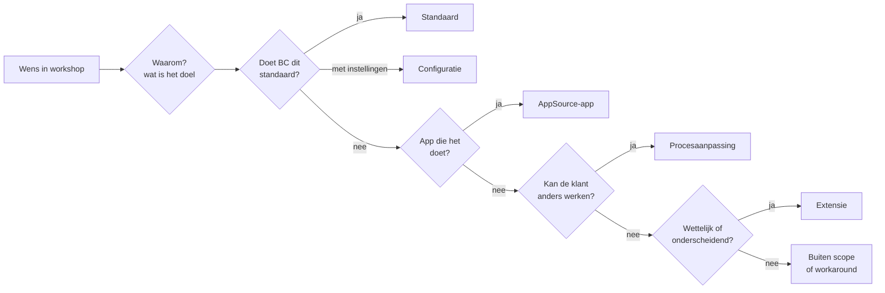

# Fit-gap: methode

> Wat: hoe ik van een workshopwens naar een beslissing kom, en welke regels elk register volgt. Voor wie: klant, projectmanager, developer — en wie wil begrijpen waarom het register eruitziet zoals het eruitziet. Het register zelf: [fit-gap.md](fit-gap.md) (ook als [CSV voor Excel](fit-gap.csv)). Vorige stap: [order-to-cash](../02-processen/order-to-cash.md) · volgende: [oplossingsontwerp](../04-oplossingsontwerp/README.md).

## Van wens tot beslissing

Dit is de volgorde uit [ADR-001](../adr/adr-001-standaard-eerst.md). Ze loopt van goedkoop en upgradeveilig naar duur en onderhoudsgevoelig.

## Regels voor elke regel in het register

Een fit-gap is pas bruikbaar als de projectmanager er een budget op kan zetten en de klant ermee kan kiezen. Daarom heeft elke regel:

| Veld | Waarom |
|---|---|
| ID en bron (workshop) | terug te vinden waar de wens vandaan kwam |
| Behoefte in de taal van de klant | de klant herkent zijn eigen vraag |
| Wat BC standaard doet | eerst de standaard, dan pas de gap |
| Fit of gap + classificatie | één van zes klassen, nooit "deels" |
| Oplossing | concreet genoeg voor een inschatting |
| Inschatting in dagen | voor de projectmanager en de offerte |
| Upgraderisico | maatwerk kost ook bij elke jaarlijkse update |
| Beslisser bij de klant | de consultant beslist niet over het proces van de klant |
| Test of migratiecontrole | elke requirement in scope wordt ergens gecontroleerd |

Deze regels worden automatisch gecontroleerd (`tests/fit-gap.test.mjs`): een regel zonder beslisser, zonder test, of een "fit" die toch met maatwerk wordt opgelost, laat de controle falen.

## Resultaat voor Kalvaert

- <!--n:req.total-->25<!--/n--> requirements uit <!--n:workshops.total-->5<!--/n--> workshops: <!--n:req.fit-->18<!--/n--> fit, <!--n:req.gap-->7<!--/n--> gap.
- <!--n:cls.standaard-->6<!--/n--> standaard, <!--n:cls.configuratie-->10<!--/n--> configuratie, <!--n:cls.app-->2<!--/n--> app, <!--n:cls.procesaanpassing-->4<!--/n--> procesaanpassing, <!--n:cls.extensie-->1<!--/n--> extensie, <!--n:cls.buiten-scope-->2<!--/n--> buiten scope.
- Gekozen scenario: <!--n:decided.days-->29,0<!--/n--> dagen (<!--n:decided.cost-->€26.100<!--/n-->). Als elke gap met maatwerk was opgelost: <!--n:max.days-->40,5<!--/n--> dagen (<!--n:max.cost-->€36.450<!--/n-->) en <!--n:max.extensions-->3<!--/n--> extensies om bij elke update te testen.

*Inschattingen en dagtarief zijn illustratieve aannames.*

## Wat ik niet in de fit-gap zet

- Technische ontwerpkeuzes van de developer (welke events, welke tabellen): die staan in de [spec](../05-specs/uc-vk-10-verwijderingsbijdrage.md) als *wat*, niet als *hoe*.
- Prijzen van apps: de licentie wordt vermeld, het bedrag komt uit de offerte van de accountmanager.
