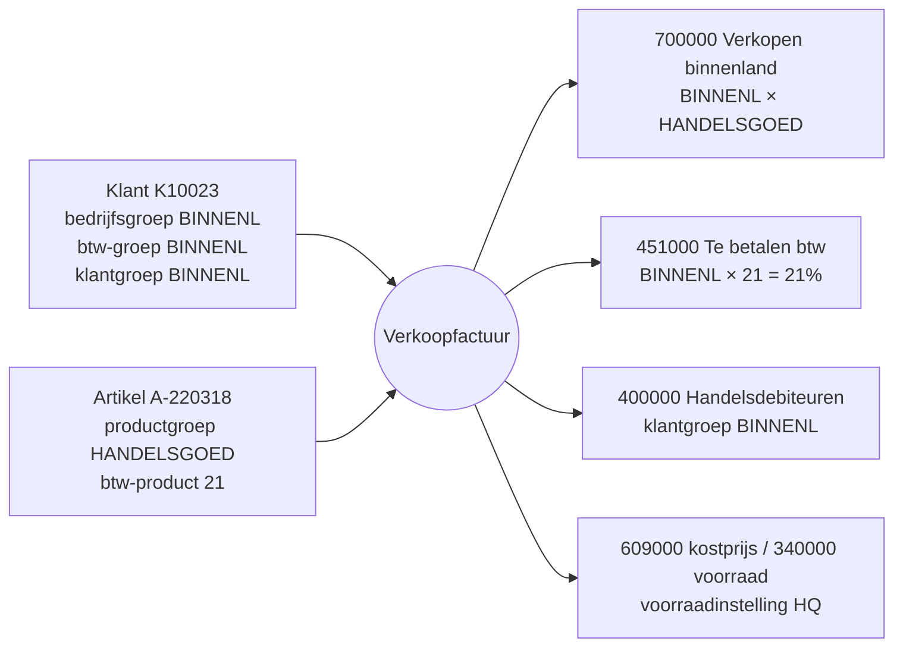

# Oplossingsontwerp — hoe Business Central voor Kalvaert ingericht wordt

> Wat: de belangrijkste instellingen, elk met de requirement waar ze vandaan komen en het boekingsgevolg. Voor wie: boekhoudkantoor (aftekenen financiën), developer en support (begrijpen waarom), de volgende consultant. Volledige tabellen: [boekingsmatrix](boekingsmatrix.md). Vorige stap: [fit-gap](../03-fit-gap/fit-gap.md) · volgende: [spec VK-10](../05-specs/uc-vk-10-verwijderingsbijdrage.md).
>
> *Rekeningnummers en codes zijn illustratief.*

## De regel: elke instelling heeft een reden

Een setup-document dat alleen zegt *wat* er ingesteld is, helpt niemand na de go-live. Elke instelling hieronder verwijst naar een requirement. Wie later vraagt "waarom staat dit zo?", vindt het antwoord.

| ID | Gebied | Wat | Waarom (requirement) |
|---|---|---|---|
| SET-REKENINGEN | Financiën | rekeningschema volgens het boekhoudkantoor | FIN-01 |
| SET-GENPOST | Financiën | algemene boekingsgroepen BINNENL / EU / EXPORT × HANDELSGOED / DIENST / BIJDRAGE | omzet per markt apart; bijdragen apart (VK-10) |
| SET-BTW | Financiën | btw-matrix met roosters | FIN-02 |
| SET-DIM | Financiën | dimensies VESTIGING en AFDELING | FIN-04 |
| SET-PRIJS | Verkoop | prijslijsten per klantkortingsgroep + uitzonderingen | VK-01 |
| SET-BETWIJZE | Verkoop | betalingswijzen CONTANT en KAART met tegenrekening | VK-03 |
| SET-KLANTSJABLOON | Verkoop | klantsjablonen NIEUW, BINNENL, EU, EXPORT | VK-05, EF-03 |
| SET-WORKFLOW | Aankoop | goedkeuring aankooporder > €5.000 | AK-01 |
| SET-CONFIGPAKKET | Aankoop | configuratiepakket prijslijsten | AK-02 |
| SET-LOCATIES | Voorraad | HQ, FILIAAL, IN-TRANSIT | VR-01 |
| SET-EDOC | E-facturatie | e-documentdienst Peppol + connector | EF-01, EF-02 |

(<!--n:setup.settings-->12<!--/n--> hoofdinstellingen; daarnaast de gewone stamdata en nummerreeksen.)

## Boekingsgroepen in één zin

Wie een factuur maakt, kiest nooit een grootboekrekening, alleen een klant en een artikel. Hun **boekingsgroepen** bepalen de rekening.

Probeer het met andere klanten en artikels in de [workbench](../../site/workbench/index.html) (stap "Boekingsgevolg").

## Keuzes die ik met het boekhoudkantoor maakte

1. **Omzet per markt op aparte rekeningen** (700000 / 700100 / 700200). Kan ook met één omzetrekening en een dimensie MARKT, maar het kantoor wil de btw-controle (rooster 03 / 46 / 47) per rekening kunnen afpunten.
2. **Kostprijs verkopen op 609000** (voorraadwijziging) in plaats van 604000. Keuze van het kantoor (open vraag uit W-FIN): zo blijven aankopen en voorraadwijziging gescheiden zoals in hun jaarrekening.
3. **EU-klanten met btw-verlegging**, niet met 0% normale btw. Voor verkoop maakt het geen verschil op de factuur; voor aankopen bij EU-leveranciers boekt BC dan automatisch zowel te betalen als terug te vorderen btw (roosters 86, 55 en 59).
4. **Geen combinatie EU × BIJDRAGE.** De bijdrage wordt alleen bij Belgische leveringen toegevoegd. Ontbreekt een combinatie die wél nodig is, dan weigert BC te boeken — de test `tests/posting.test.mjs` controleert vooraf elke combinatie die in de stamdata voorkomt.

## Dimensies

| Dimensie | Waarden | Komt van | Regel |
|---|---|---|---|
| VESTIGING (globaal 1) | HQ, FILIAAL | locatie en verkoper | code verplicht op omzet en kostprijs |
| AFDELING (globaal 2) | BINNENDIENST, BALIE, PROJECTEN | verkoper | code verplicht op omzet |

Eerst gevraagd welke rapporten de zaakvoerder maandelijks wil zien (marge per vestiging en per afdeling); daaruit volgen de dimensies — niet omgekeerd.

## Goedkeuring aankoop (AK-01)

Standaardworkflow "goedkeuring aankooporder". Aankoper heeft een limiet van €5.000; daarboven gaat het verzoek naar de zaakvoerder. Melding via e-mail en Teams. Bij afwijzing gaat de order terug naar "open" met de reden. Test: UAT-07.

## Wat bewust standaard blijft

Deelleveringen, ontvangsten, telling, CODA, aanmaningen: geen aanpassing, alleen instellingen. Elke aanpassing hier zou bij elke update opnieuw getest moeten worden zonder dat de klant er iets aan wint.
