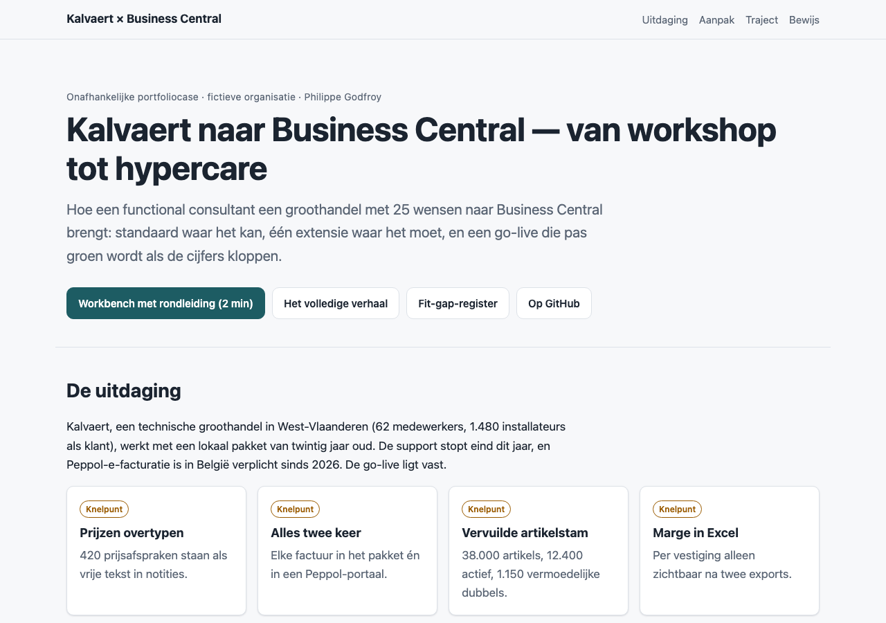
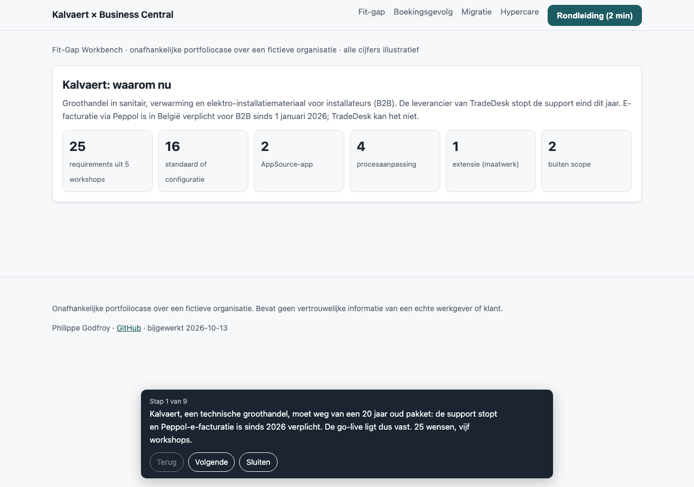
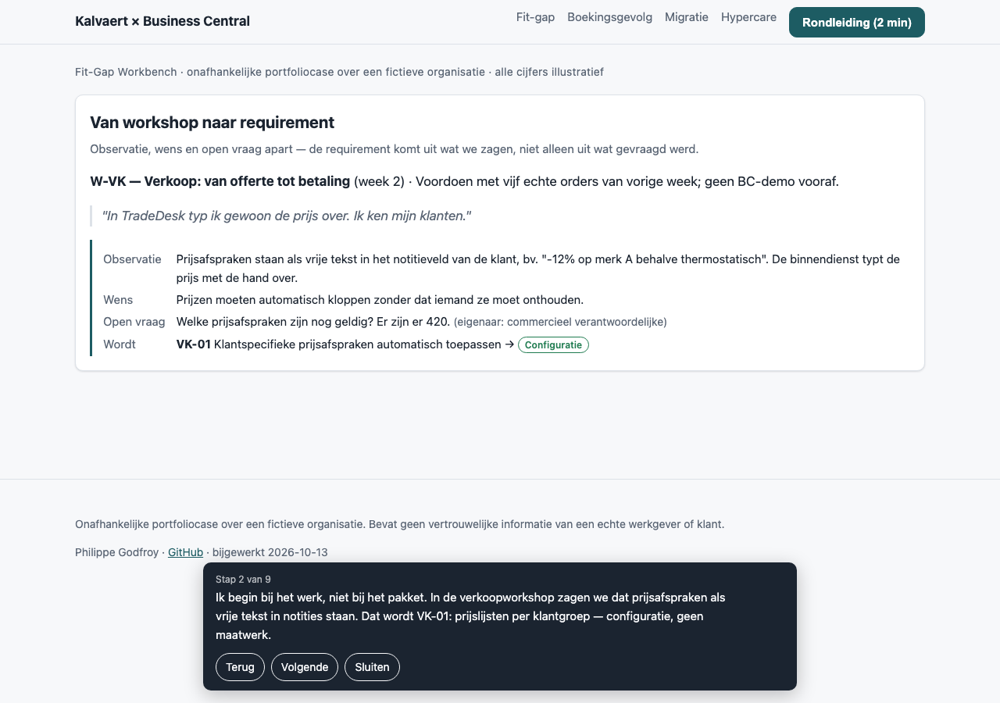
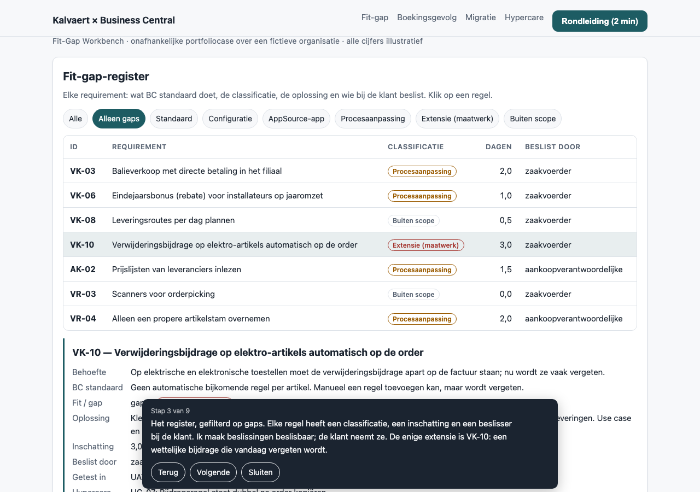
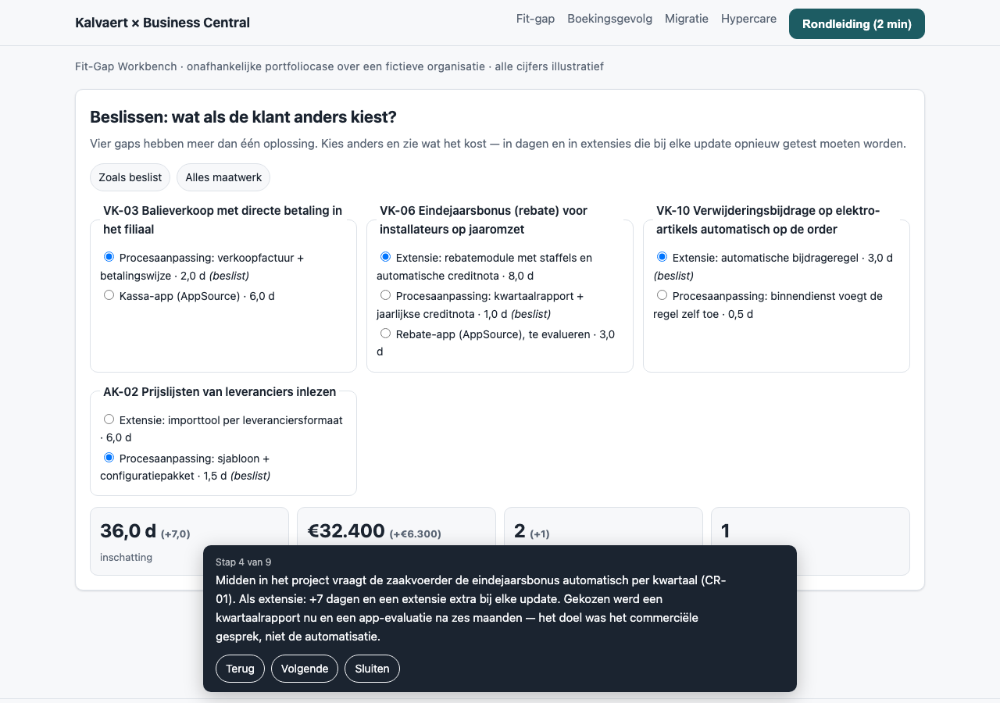
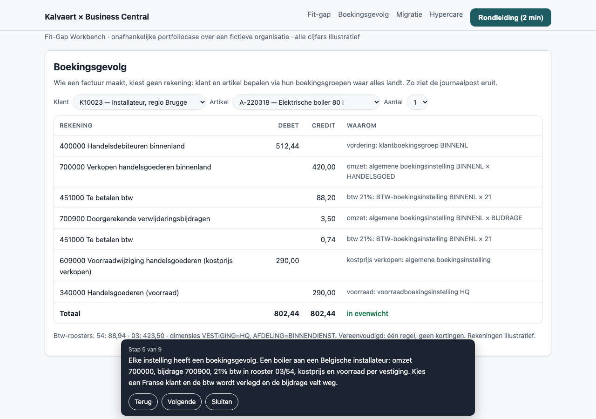
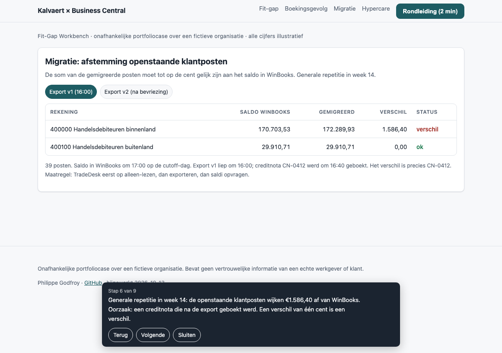
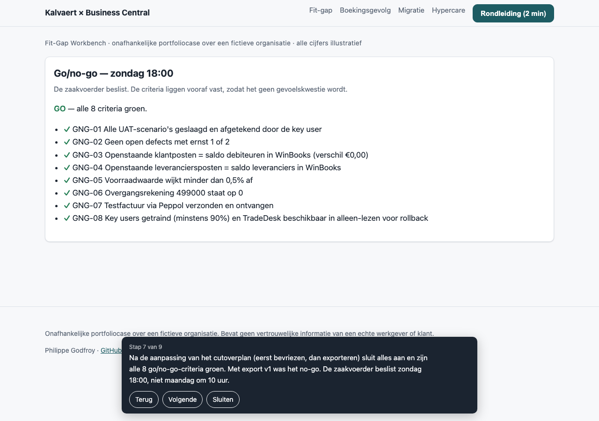
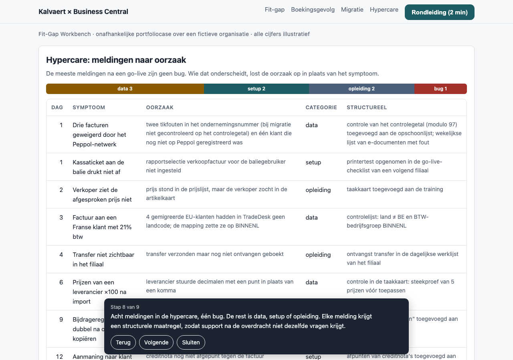
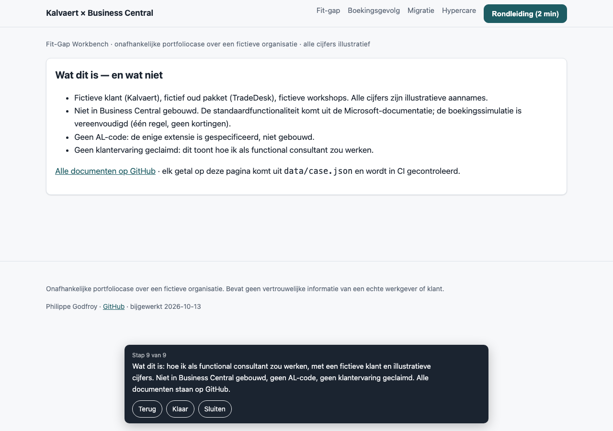

# Schermafbeeldingen van de rondleiding

> Voor als de [workbench](../../site/workbench/index.html) niet laadt. Elke afbeelding toont één stap van de rondleiding van 2 minuten. Gemaakt met `?tour=<stap>&shot` (lichte weergave, alleen het paneel van die stap).
>
> Onafhankelijke portfoliocase over een fictieve organisatie; alle cijfers illustratief.

| Stap | Wat je ziet | Afbeelding |
|---|---|---|
| — | Landingspagina |  |
| 1 | Kalvaert en waarom nu: <!--n:req.total-->25<!--/n--> requirements per classificatie |  |
| 2 | Van workshop naar requirement (VK-01) |  |
| 3 | Fit-gap-register, gefilterd op gaps; detail van de enige extensie |  |
| 4 | Change request: wat als de eindejaarsbonus een extensie wordt |  |
| 5 | Boekingsgevolg van een boiler aan een Belgische installateur |  |
| 6 | Afstemming met export v1: <!--n:mig.diff.v1-->€1.586,40<!--/n--> verschil |  |
| 7 | Go/no-go met export v2: alle <!--n:gng.total-->8<!--/n--> criteria groen |  |
| 8 | Hypercare: <!--n:hc.total-->8<!--/n--> meldingen naar oorzaak |  |
| 9 | Wat dit is en wat niet |  |
